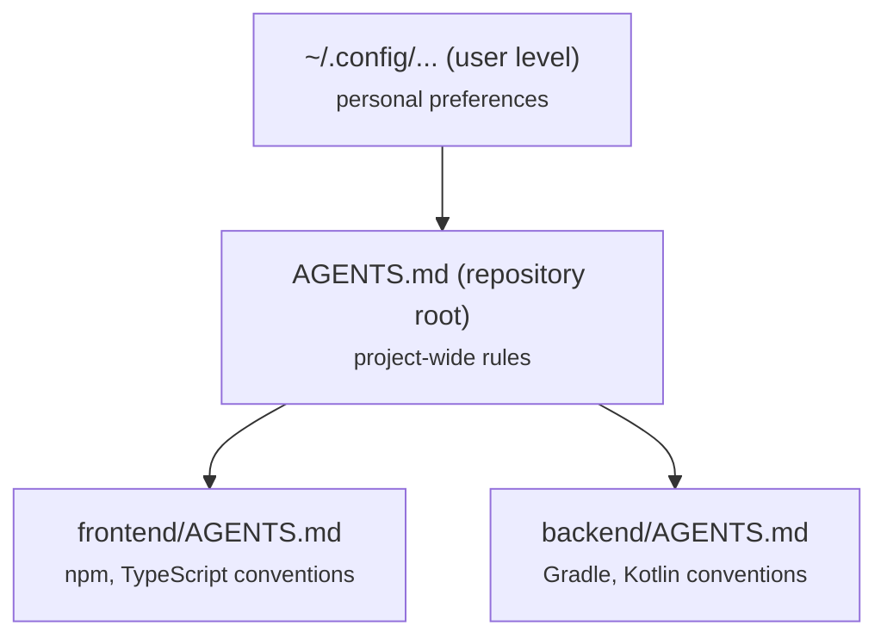

# Context engineering

---

## The amnesiac contributor

Every agent session starts *from scratch*:

* It does not remember previous sessions
* It does not know *how to build* your project, which conventions you follow, what *must not* be touched
* It can *discover* some of it by exploring the repository, but:
    * exploring costs *time*, *money*, and *context space*
    * some knowledge is *not in the code* (e.g., "never edit generated files", "we deploy on Fridays only")

<br>

**Context engineering**: deciding *what information* reaches the model, *when*, and *in which form*

The project-specific part of the context belongs **in the repository**, versioned and reviewed like code

---

## `AGENTS.md`: a README for agents

A plain Markdown file at the repository root, read automatically at the beginning of every session

* An *open convention* ([agents.md](https://agents.md)), supported by most coding agents
    * Now stewarded by the *Agentic AI Foundation* (Linux Foundation)
* No mandatory structure: it is just Markdown

```markdown
# AGENTS.md

## Build and test
- Build with `./gradlew assemble`, run all checks with `./gradlew check`
- Never run `./gradlew publish`: releases are performed by CI only

## Conventions
- Kotlin, official code style, enforced by ktlint (`./gradlew ktlintFormat` to fix)
- Commit messages follow Conventional Commits

## Project structure
- `core/`: domain model, no external dependencies allowed
- `web/`: HTTP adapter, depends on `core`
- Files under `build/` and `generated/` are produced by the build: never edit them
```

---

## What to write in `AGENTS.md`

| ✅ Write | ❌ Do not write |
|---|---|
| Commands to build, test, lint, run | Things evident from the code or the build files |
| Non-obvious conventions and constraints | Generic advice ("write clean code") |
| What must **never** be done | Long tutorials (link them instead) |
| Where things are, when not obvious | Information that changes often |
| Known pitfalls of the project | Secrets (it is a *public*, *versioned* file!) |

<br>

* It is loaded in *every* session: **every line costs** context, attention, and money
* Treat it as code: *review* changes, *keep it current*, delete what is no longer true
* A good practice: when the agent makes a mistake you had to correct, ask *"would a line in `AGENTS.md` have prevented it?"*

---

## Hierarchical context

In large repositories (*monorepos*), different parts follow different rules



* Agents read the `AGENTS.md` files *on the path* to the files they work on
* The *closest* file is the most specific: on conflicts, it wins
* User-level instructions hold *personal* preferences, not project rules
* Explicit instructions in the prompt override everything

---

## Vendor-specific instruction files

Before `AGENTS.md`, every tool had its own file, and many still read their own *in addition*:

* `.github/copilot-instructions.md`, `CLAUDE.md`, `GEMINI.md`, `.cursor/rules/`, ...

<br>

**Single source of truth**: keep `AGENTS.md` as the real file, and make the others *point to it*

```bash
ln -s AGENTS.md CLAUDE.md         # a symbolic link
```

or, where supported, a one-line file *importing* `AGENTS.md`

Vendor-specific files should only contain what is *genuinely* vendor-specific
