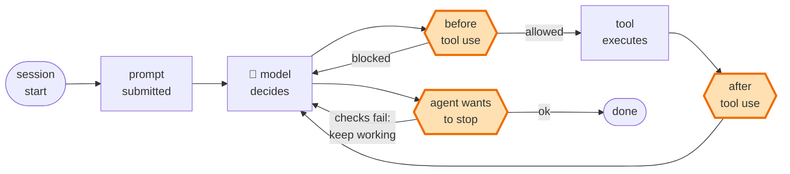
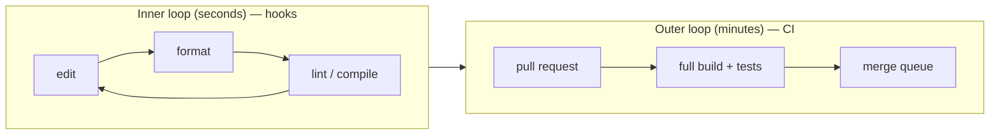

# Hooks, permissions, and sandboxes

---

## Instructions are not guarantees

> "Always run the formatter after editing a file"

Written in `AGENTS.md`, this is a **wish**: the model *usually* complies, *sometimes* forgets

When something **must** happen (or **must not** happen), we need *deterministic* mechanisms,
enforced by the *harness*, not by the model

* **Hooks**: commands executed automatically at given points of the agent loop
* **Permissions**: which tools and commands are allowed, denied, or need approval
* **Sandboxes**: OS-level isolation of what the agent's commands can touch

---

## Hooks

User-defined commands that the harness runs on **lifecycle events**

| Event | Example |
|---|---|
| Before tool use | Block `git push --force`, block edits to generated files |
| After tool use | Run the formatter on every edited file |
| Agent wants to stop | Run the tests: if they fail, send the agent back to work |
| Session start | Inject dynamic context (current branch, open issues) |

Supported by several agents, with *different configuration formats*: not standardized yet

---

## Hooks: CI for the inner loop

Hooks bring *continuous integration* ideas **inside** the agent session

* Errors caught by a hook are fixed *immediately*, by the agent itself, for free
* Errors caught by CI require *another round*: push, wait, read logs, fix
* Same principle as `git` pre-commit hooks: **fail fast**, as close as possible to the change
* Hooks do *not* replace CI: they run on an uncontrolled machine, and can be bypassed

---

## Permissions and sandboxing

Agents execute *arbitrary commands* on your machine, with *your* credentials

* **Permission modes**: ask for every action, allow edits only, allow everything...
* **Allow/deny lists**: e.g., allow `./gradlew test`, deny `rm -rf`, deny reading `.env`
    * Can be versioned in the project, shared with the team
* **Sandboxing**: the OS restricts filesystem and network access of the agent's commands
    * e.g., write only inside the project, network only towards selected domains
* **Containers / VMs**: run the agent in a disposable environment (as in CI)

 

**Principle of least privilege**: grant the agent the *minimum* it needs for the task

The more autonomous the agent, the *stronger* the isolation must be
