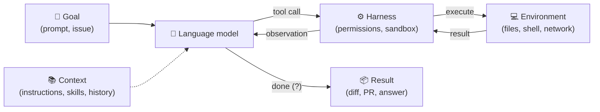
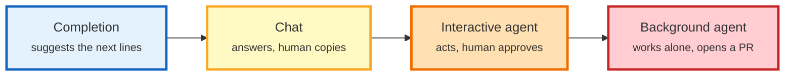

# From bots to agents

---

## Automation so far

We already delegate a lot of work to machines:

* **Build automation**: compile, test, package
* **Continuous integration**: verify every change, on fresh machines
* **Bots**: open pull requests for dependency updates (Renovate, Dependabot)
* **Merge queues**: integrate changes while keeping the main branch green

 

All of them are **deterministic**:
 
same input $\Rightarrow$ same output, and their behavior is *fully specified* by their configuration

---

## Software agents

An (LLM-based) **agent** is a program that uses a language model to *decide* which actions to take,
*executes* them via **tools**, *observes* the results, and *iterates* until it believes the goal is reached

* **Model**: *proposes* the next action (text $\rightarrow$ text)
* **Tools**: read/write files, run shell commands, call APIs...
* **Harness**: the program running the loop, enforcing what the agent can and cannot do
* **Context**: everything the model "knows" in this session, *limited* in size

---

## Agents are not bots

| | Bots (e.g., Renovate) | Agents |
|---|---|---|
| Behavior | Specified by configuration | *Emerges* from model + context + environment |
| Determinism | Yes | **No**: same task, different results |
| Scope | Narrow (e.g., version bumps) | Open-ended (any task describable in text) |
| Failure mode | Fails loudly | May fail *silently*, or *"believe"* it succeeded |
| Configuration | A file with a schema | Natural language + tools + permissions |

 

An agent is closer to a **new (fast, tireless, and unreliable) contributor** than to a tool

---

## Levels of autonomy

* **Interactive agents** run on the developer's machine (in a terminal or in the IDE)
    * The human watches, approves risky actions, and steers
* **Background agents** run on a *remote machine* (a CI runner, a cloud sandbox)
    * Triggered by an issue, a comment, a schedule; deliver a *pull request*
* Moving right: *less human attention per change*, **more need for automated verification**

---

## Why is this a DevOps topic?

Agents are *new contributors* to the software process, and they raise *familiar* problems:

* **Configuration**: instructions, skills, tools, and permissions for agents
  *live in the repository*, and are versioned like code
* **Reproducibility**: agents must know how to build and test the project, *without asking*
* **DRY**: the same agent configuration is needed in many repositories $\Rightarrow$ *packaging and distribution*
* **Automation**: agents can run *inside CI*, triggered by events
* **Security**: agents execute code, hold credentials, and read *untrusted* text
* **Quality control**: more changes, faster, of *variable* quality $\Rightarrow$ verification pipelines matter *more*, not less

 

The rest of this lecture is **vendor neutral**: tools change every few months, concepts do not
