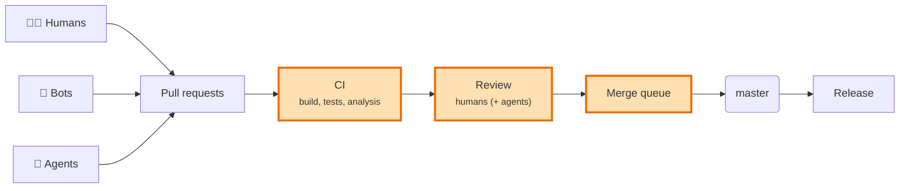

# The pipeline is the guardrail

---

## More contributors, same main branch

Agents increase the *number* of changes, and their quality is *variable*

* Every gate we built in this course applies to agents *unchanged*
* An agent cannot be trusted to *verify itself*: verification must be **external**
* Weak tests $\Rightarrow$ agents produce code that *passes* weak tests

**The quality of an agent's output is bounded by the quality of your verification pipeline**

---

## Evidence so far

The literature is young, and results are *mixed*:

* *Experienced* developers on *large*, familiar open source projects
  were **slowed down** (**-19%**) by AI tools, while *believing* they were faster
    * METR, 2025 ([paper](https://arxiv.org/abs/2507.09089),
      [summary](https://metr.org/blog/2025-07-10-early-2025-ai-experienced-os-dev-study/))
* AI acts as an **amplifier**: it magnifies the strengths of *well-organized* teams
  and the dysfunctions of struggling ones
    * Foundations (version control practices, small batches, code review, platform quality)
      determine whether AI *helps* or *hurts*
    * DORA, *State of AI-assisted Software Development*, 2025 ([report](https://dora.dev/dora-report-2025/))

 

DevOps practices are not made obsolete by agents: they are **what makes agents usable**

---

## Responsibility does not delegate

* Whoever *merges* a change is responsible for it, regardless of who wrote it
* Reviewing is *harder* than writing: agent-generated PRs can be large, plausible, and subtly wrong
    * Ask for *small* PRs, with *tests*, and a clear description
* *Understand* what you merge: if you cannot explain it, do not merge it
* Many projects now ask contributors to *disclose* AI assistance in their contributions
