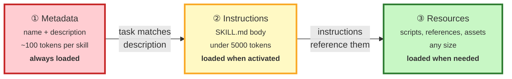

# Skills

---

## The limits of `AGENTS.md`

`AGENTS.md` is loaded **always** $\Rightarrow$ it must be *short*

But many procedures are *long*, *detailed*, and needed only *sometimes*:

* How to adapt the code when a dependency update *breaks* the build
* How to add a new database migration
* How to write a new slide deck for this course
* How to triage a bug report

<br>

We need knowledge that is **available** to the agent, but **loaded only when relevant**

---

## Agent Skills

A **skill** is a *folder* containing instructions, and optionally scripts and resources,
that the agent loads *on demand*

* Open specification: [agentskills.io](https://agentskills.io/specification), supported by most coding agents

```text
dependency-migration/
├── SKILL.md        # required: metadata + instructions
├── scripts/        # optional: executable code
│   └── find-usages.sh
├── references/     # optional: documentation, read when needed
│   └── past-migrations.md
└── assets/         # optional: templates, data files
    └── migration-notes-template.md
```

* Skills can be *project-level* (versioned in the repository) or *user-level* (personal)
* The project-level location is not standardized yet (e.g., `.agents/skills/`, `.claude/skills/`, `.github/skills/`)

---

## `SKILL.md`

Bots open the update PR, CI goes red: fixing it requires *understanding*, not just a version bump

```markdown
---
name: dependency-migration
description: >-
  Adapts the code base to a new major version of a dependency.
  Use when a dependency update pull request fails to build or test.
---

# Migrating to a new dependency version

1. Identify the dependency and the old and new versions from the pull request
2. Read the upstream changelog and migration guide *before* touching the code
3. Run `scripts/find-usages.sh <dependency>` to locate the affected code
4. Check `references/past-migrations.md` for project-specific pitfalls
5. Adapt the code with minimal changes, without altering behavior.
   Never disable, delete, or weaken tests to make them pass
6. Run `./gradlew check` until it succeeds, then push to the same branch
7. Fill `assets/migration-notes-template.md` in the PR description,
   listing what needs human attention
8. If the migration requires a design decision, stop and ask in a comment
```

* `name`: lowercase, digits, hyphens; must match the folder name
* `description`: **what** the skill does and **when** to use it
    * The agent decides whether to load the skill *based on this text only*
* Body: plain Markdown instructions, referencing the other files in the folder

---

## Progressive disclosure

Skills are designed to cost *almost nothing* until they are needed



* Hundreds of skills can be installed without filling the context
* Scripts are *executed*, not read: their code does not even enter the context

---

## Instructions, skills, or scripts?

| | `AGENTS.md` | Skill | Script / build task |
|---|---|---|---|
| Loaded | Always | When relevant | When executed |
| Content | Short facts and rules | Procedures, know-how | Code |
| Deterministic | No | No | **Yes** |
| Usable by humans and CI | Readable | Readable | **Yes** |

<br>

**Whatever can be deterministic, should be deterministic**

* A skill should *call* a script or a build task, rather than describing ten manual steps
* The script is testable, reusable by humans and CI, and does not depend on the model "following" the instructions
* Skills are best for what *cannot* be easily scripted: judgment, choices, reviews, writing
