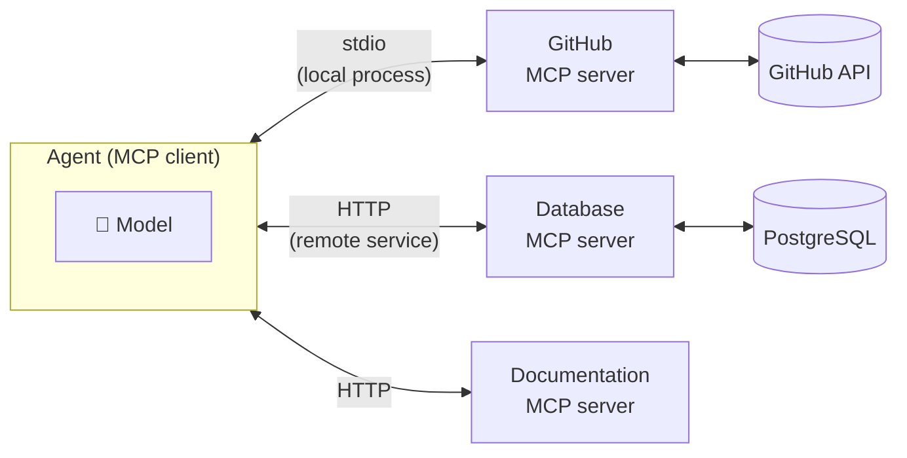

# Tools and the Model Context Protocol

---

## What an agent can do

An agent acts on the world *only* through **tools** provided by the harness

* **Built-in tools** (in practice, in every coding agent):
    * read, search, and edit files
    * run shell commands
    * fetch web pages
* **Command line tools** already installed: `git`, `gh`, `./gradlew`, `docker`, ...
    * Language models know popular CLIs well, and CLIs are *composable*
    * Often, a CLI plus a skill describing how to use it is all you need
* **External tools**: issue trackers, databases, browsers, design tools, documentation servers...
    * Each with its own API and authentication $\Rightarrow$ we need a *standard way to plug them in*

---

## Model Context Protocol (MCP)

An *open protocol* to connect agents (*clients*) to external capabilities (*servers*)

* Stewarded by the *Agentic AI Foundation* (Linux Foundation)



A server exposes:

* **Tools**: functions the model can call (e.g., `create_issue`, `run_query`)
* **Resources**: data the agent can read (e.g., files, records)
* **Prompts**: reusable templates

Write a server *once*, use it from *any* MCP-compatible agent

---

## Configuring MCP servers in a project

Project-level configuration can be *versioned*, so the whole team (and CI) gets the same tools

```json
{
  "mcpServers": {
    "issue-tracker": {
      "type": "http",
      "url": "https://tracker.example.com/mcp"
    },
    "database": {
      "command": "npx",
      "args": ["-y", "some-db-mcp-server@1.4.2", "--read-only"],
      "env": { "DB_URL": "${DB_URL}" }
    }
  }
}
```

* File name and exact schema vary across agents, but the structure is always similar
* **Never commit credentials**: reference environment variables
* **Pin versions**: an MCP server is code that runs with your permissions
* Prefer *read-only* modes when writing is not needed

---

## Tools have a cost

Every tool definition is *sent to the model* and occupies context

* Dozens of servers with hundreds of tools can eat a large part of the context *before any work is done*
* More tools $\Rightarrow$ more chances that the model picks the *wrong* one

<br>

Rules of thumb:

* Enable only the servers you *actually need*, per project
* Prefer a well-known CLI when one exists
* Use MCP when there is no CLI, when authentication is complex, or when structured access matters
