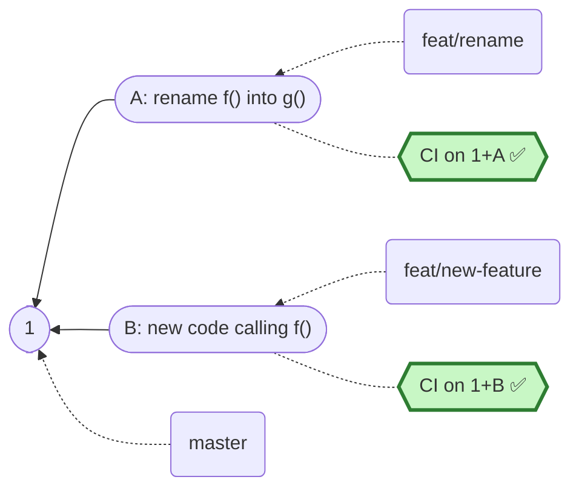
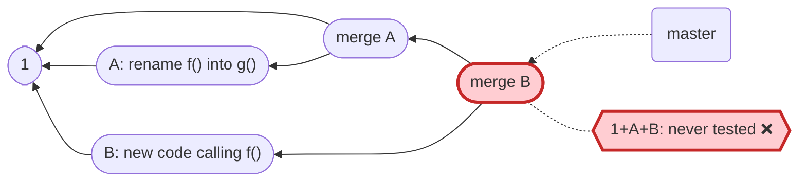
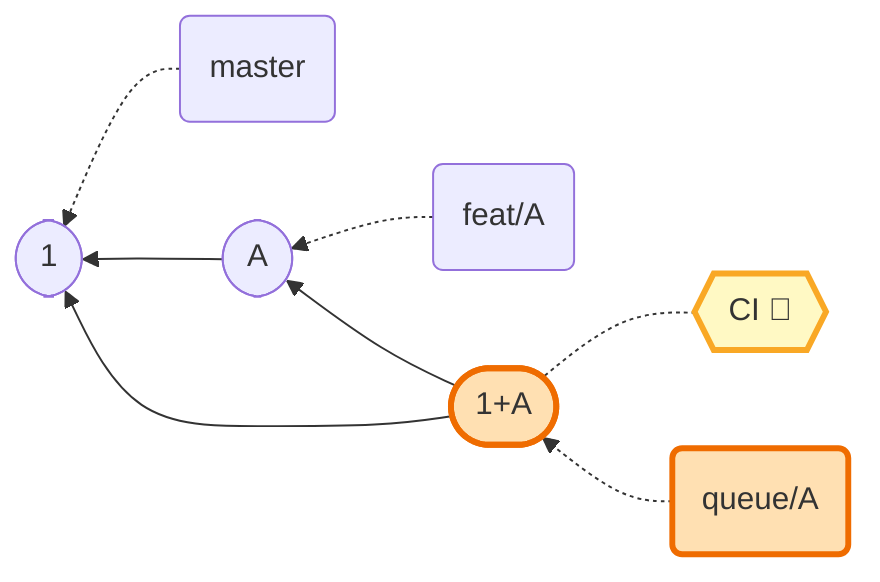
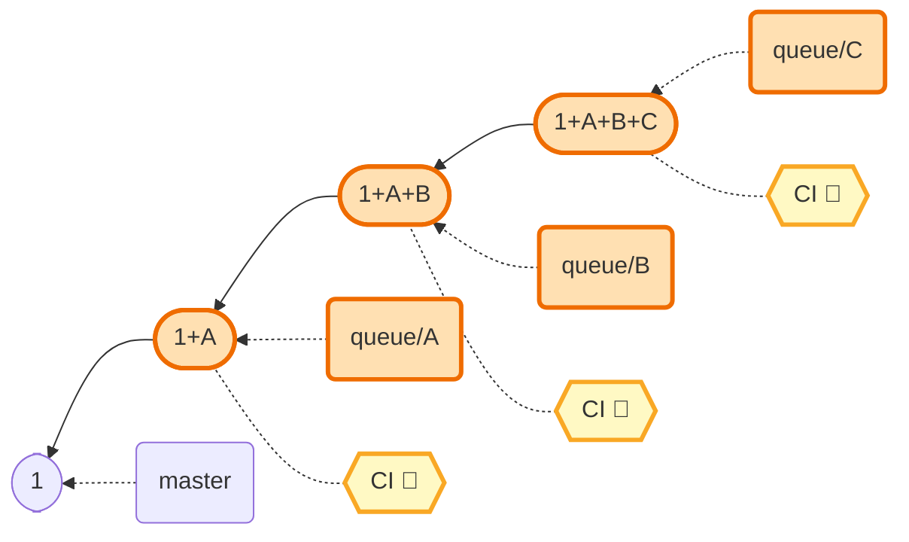
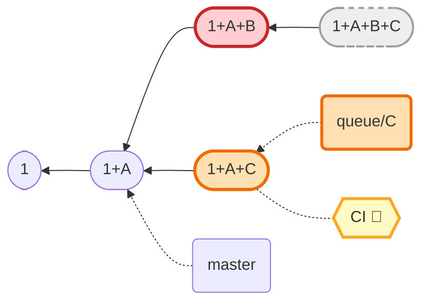
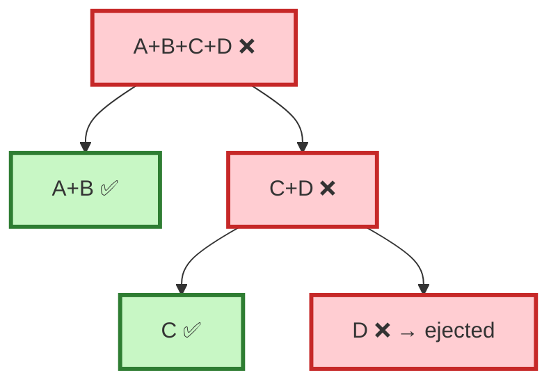
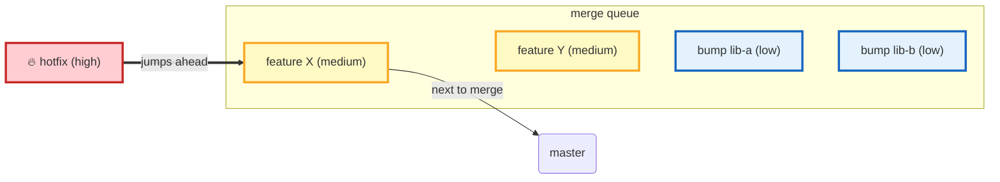

# Merge queues

---

## Protecting the main branch

Once a project has CI, the main branch should only receive *verified* changes

Repository hosting platforms can *enforce* rules on selected branches:

* **No direct pushes**: changes enter only via pull requests
* **Required status checks**: selected CI jobs must succeed before merging
* **Required reviews**: at least $n$ approvals from (selected) humans
* **Linear history**: only fast-forward, rebase, or squash merges
* **Signed commits**, no force pushes, no deletion...

 

The platform does the policing, so humans (*and bots*) cannot skip the rules by mistake

---

## Green pull requests, red main branch

Two pull requests, opened from the same commit, both *pass* CI

There is *no textual conflict*: they touch different files

---

## Green pull requests, red main branch

Merge both, and the main branch **no longer compiles**: `f()` does not exist anymore

* CI validated $1+A$ and $1+B$, but what got into `master` is $1+A+B$
* **Semantic conflict**: changes that are fine in isolation, but broken together
* The more people (and bots, and agents) contribute, the more likely this gets

---

## The "not rocket science" rule

> Automatically maintain a repository of code that always passes all the tests
>
> --- Graydon Hoare (creator of Rust), describing the `bors` bot, 2014
> ([source](https://web.archive.org/web/20251220014900/https://graydon.livejournal.com/186550.html))

 

Reformulated:

**the main branch can only move to a commit that has been tested *exactly as it will be***

 

A pull request being green is *not enough*:
 
it must be green *on top of the current main branch*

---

## Naive solution: require up-to-date branches

Before merging, the branch must contain the *latest* main branch:

1. Update (merge/rebase) the PR branch on top of `master`
2. Re-run CI
3. Merge, *if nobody merged in the meanwhile*, otherwise go back to 1.

 

It works, but it **does not scale**:

* Pull requests are integrated *one at a time*
* With $n$ ready PRs and a CI taking $t$, the last one waits *at least* $n \cdot t$
* Every merge *invalidates* all other PRs, which must update and re-run CI again
* Humans end up *racing* to merge first, and babysitting PRs

---

## Merge queue: the idea

Ready PRs are not merged: they are **enqueued**

The queue *builds the future main branch*, tests it, and only then moves `master`

1. A *temporary branch* is created with the PR merged on top of the current `master`
2. CI runs on the *temporary branch*
3. If CI passes, `master` is moved to the *tested* commit, otherwise the PR is *ejected*

---

## Speculative checks

Testing one PR at a time is *safe* but *slow*

**Bet** on success: test each PR *on top of all the PRs ahead of it in the queue*, *in parallel*

* If everything passes, `master` fast-forwards to $1+A+B+C$: three PRs in the time of *one* CI run
* The price: *more CI runs in parallel* (and wasted ones if the bet fails)

---

## Speculative checks: when the bet fails

$B$ breaks the build: $B$ is ejected, and **every speculation built on top of it is discarded**

* $A$ passed, so `master` advances to $1+A$
* $C$ is *re-tested* on top of the new hypothetical future: $1+A+C$
* The author of $B$ is notified, fixes the problem, and re-enqueues

---

## Batching

Alternative (or complement) to speculation: test **many PRs together, with a single CI run**

If the batch passes, all PRs are merged at once.
 
If it fails, *who is guilty*? **Split** the batch and test the halves (*bisection*, as in `git bisect`)

* *Cheap* when failures are rare: one CI run for many PRs
* *Expensive* when failures are frequent: $\log_2(n)$ extra rounds to find the culprit
* Works well with *many small, low-risk* PRs (e.g., dependency updates)

---

## Priorities

Not all changes are equally urgent:

* A *security fix* or a *hotfix* for a broken release should not wait behind 20 dependency updates
* *Dependency updates* (from bots) can wait

* **Priority**: higher-priority PRs are placed *ahead* in the queue
* **Preemption** (optional): running checks of lower-priority PRs are *interrupted*, wasting CI time
* **Multiple queues**: different rules (batch size, checks) for different kinds of changes

---

## Merge queues: costs and pitfalls

* **CI must run on the queue's temporary branches**, not only on PRs
    * If a required check never runs there, the queue *stalls forever*
* **More CI time**: every PR is tested at least twice (as PR, and in the queue)
    * Option: run *fast* checks on PRs, and the *expensive* ones only in the queue
* **Flaky tests poison the queue**: a random failure ejects an innocent PR,
   and invalidates all speculations behind it
    * Options: retry failed checks, *fix flaky tests* (better)
* **Long pipelines** make the queue slow: speculation and batching mitigate, but do not cure
* **One more moving part**: when something does not merge, someone has to understand *why*

---

## Merge queue implementations

| Tool | Notes |
|------|-------|
| `bors` | The original (Rust project, 2014), now retired |
| Zuul | OpenStack's CI gatekeeper, pioneered speculative execution |
| GitLab *merge trains* | Built into GitLab |
| GitHub merge queue | Built into GitHub (org-owned repositories), CI must listen to the `merge_group` event |
| **Mergify** | GitHub App, *configuration as code*, priorities, multiple queues |
| Aviator, Trunk, Graphite | Commercial services, often monorepo-oriented |

 

Same concepts everywhere: **queue**, **temporary branch**, **speculation**, **batching**, **priorities**
