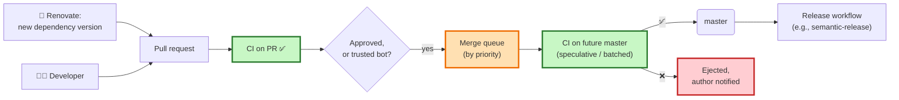

## Mergify

[Mergify](https://mergify.com) is a *GitHub App* that automates pull request workflows

* Free for open source projects
* Configured *as code*, in a `.mergify.yml` file at the repository root
    * Versioned, reviewed, and shareable across repositories via `extends:`
* A general **rule engine**: `conditions` $\Rightarrow$ `actions`
    * Merge queue, merge, rebase, label, comment, backport...

<br>

⚠️ It is a *third party* with *write access* to your repositories:
<br>
granting it is a **trust** decision (as for any bot, action, or agent)

---

## Mergify: queue rules

```yaml
queue_rules:
  - name: default
    queue_conditions:            # required to *enter* the queue
      - check-success=build
      - or:
        - "#approved-reviews-by>=1"
        - author=renovate[bot]
    merge_conditions:            # required to *merge*, checked on the temporary branch
      - check-success=build
    merge_method: rebase
    batch_size: 4                # up to 4 PRs tested together, split on failure

merge_queue:
  max_parallel_checks: 3         # speculative checks (1 = disabled)
```

* The queue creates *temporary draft pull requests* (branches `mergify/merge-queue/...`)
    * Your regular `pull_request` CI workflows run on them: usually **no CI changes needed**
* Branch protection rules are *automatically added* to the conditions

---

## Mergify: priorities and automatic enqueueing

```yaml
priority_rules:                  # first matching rule wins, default: medium
  - name: hotfixes first
    conditions:
      - label=hotfix
    priority: high
  - name: dependency updates last
    conditions:
      - author=renovate[bot]
    priority: low

pull_request_rules:
  - name: enqueue green dependency updates automatically
    conditions:
      - author=renovate[bot]
      - check-success=build
    actions:
      queue:
```

Humans enqueue a PR with a comment: **`@mergifyio queue`**

Validate the configuration locally (or in CI) with `mergify config validate`

---

## Putting it all together



**Fully automated evolution**, with the main branch *always green*
<br>
The same pipeline is what makes it *safe* to accept contributions from *automated agents*
